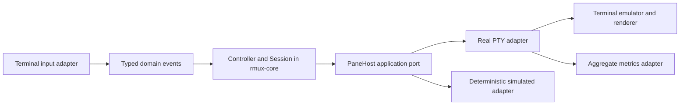

# Architecture

The workspace follows hexagonal architecture. Domain decisions are independent
of frameworks, system calls, clocks, and terminal libraries.

## Boundaries

`crates/rmux-core` owns pane identity, the layout tree, focus, zoom, split
transactions, and lifecycle decisions. `Session::apply` maps an event to typed
effects without IO. `Controller` executes effects through `PaneHost`, translating
spawn and resize failures back into domain events. A write failure produces a
bounded notice, preserving a shell when its input queue is temporarily full.

`src/adapters` owns PTYs, terminal event encoding, terminal emulation, rendering,
raw-mode restoration, signal integration, and the metrics HTTP listener.
`src/main.rs` is the composition root and attached-client event loop. Domain
events and the shell port contain no crossterm, vt100, Unix, or telemetry types.
`scripts/check-architecture.py` rejects dependencies on the core crate and checks
that every workspace package forbids unsafe code. Rust enforces the unsafe lint.

The current terminal event loop and renderer are concrete adapters, not fully
simulated ports. Their compatibility and scheduling behavior require adapter
tests. Server/client transport and virtual-clock abstractions will be introduced
with persistent sessions rather than added as unused general-purpose layers.

## Lifecycle and bounds

A split first reserves a new monotonic identifier. It commits to the layout only
after the matching shell-start acknowledgement. Failure, cancellation, and stale
acknowledgements produce cleanup effects. Resize cancels an in-flight split.
Pane IDs are never reused during a session. The last closed pane ends the session.

Sessions allow at most 32 panes. Each PTY has bounded output (64 chunks of 4 KiB)
and input (16 messages of at most 64 KiB) queues. Per-tick output processing is
bounded. Terminal history retains at most 2,000 lines per pane. Notice history
retains 32 entries. Emulator dimensions clamp to at least 2×2 to avoid known
wide-character wrapping defects in the dependency; rendering clips to the actual
viewport. Terminal dimensions also affect memory consumption; explicit
screen-memory budgets remain a hardening task. A tiny viewport temporarily shows
only the focused pane, preserving the logical tree.

## Deterministic testing

`tests/universe.rs` drives the production `Controller` using a simulated
`PaneHost`, a stable SplitMix64 PRNG, virtual time, queued events, and injected
failures. Assertions check shell ownership, identity uniqueness, valid focus,
visible geometry, limits, and cleanup. Separate layout tests compare against an
independent geometry oracle. Replays report seed and failing step with event
history. Fixed seeds run in CI; any discovered regression must become a permanent
seed or targeted regression test.

The simulation does not model kernel PTYs, real thread interleavings, network
packets, or every terminal escape sequence. Those remain explicit adapter test
obligations. Full deterministic server/transport simulation is future work.

## Terminal capabilities

Shells start with `TERM=xterm-256color`. Child output is parsed into cells; the
renderer emits its own sequences and does not forward clipboard or title
controls. The attached Linux adapter currently handles UTF-8 including wide
characters (viewport clamped to at least 2×2), SGR color and intensity, alternate
screen, application cursor keys, bracketed paste, and 2,000 lines of scrollback.
Primary device attributes (`CSI c`, `ESC Z`), secondary attributes (`CSI > c`),
device status (`CSI 5 n`), and cursor position reports (`CSI 6 n`) are answered
only to the originating pane. Replies are dropped once 1,024 bytes are pending
or the pane input queue is full.

Not supported: mouse tracking, copy mode, clipboard or title forwarding, DECRQM,
XTGETTCAP, XTVERSION, combining-character guarantees, and macOS. Query replies
are not telemetry.

## Multi-host direction

Each host will own its running processes through a per-user persistent daemon.
A client will discover and attach through SSH using the user's existing SSH
authentication and host-key verification. No unauthenticated public daemon port
is planned. Sessions remain resident on their original host; attaching from
another machine does not migrate running processes.

Before implementation, specify a versioned bounded protocol, reconnect semantics,
per-user socket authorization, client capability negotiation, multi-client resize
policy, host inventory/configuration synchronization, and failure behavior. This
work is tracked in GitHub, and Linux is the first supported platform. macOS is a
later adapter/platform milestone.
